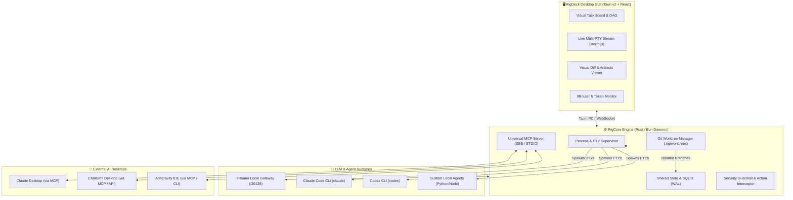

# 📑 PRODUCT REQUIREMENTS DOCUMENT (PRD)
## Project Codename: **RigDeck / OpenRig-GUI**
### *Next-Gen Autonomous Multi-Agent Mission Control & Orchestration Studio*

---

| Metadata | Detail |
| :--- | :--- |
| **Document Version** | `v1.1.0-APPROVED` (Post-Review Consensus) |
| **Date** | 2026-10-03 |
| **Authors & Reviewers** | Afgan, Antigravity, Claude Desktop (Opus 5.5), ChatGPT Desktop |
| **Architectural Consensus** | Hub-and-Spoke Blackboard (SQLite), Rust + Tauri v2 (`portable-pty`), Dual MCP & Deep Link |
| **Primary OS Target** | Linux (CachyOS GNOME Wayland & X11) & Cross-Platform |
| **Target Resource Footprint** | Idle RAM < 60 MB, Launch Time < 400ms |

---

## 1. Executive Summary & Problem Statement

### 1.1 Latar Belakang Masalah
Saat ini ekosistem AI Coding Agent terbelah menjadi dua kutub:
1. **Tool CLI Headless (OpenRig, AutoGen, CrewAI CLI, Claude Code CLI):**
   - Sangat fleksibel dan kuat dalam otomasi terminal.
   - **Kelemahan fatal:** Tampilan hitam-putih `tmux` yang kaku, sulit memantau git diff visual secara real-time, tidak ada diagram alur tugas (task DAG), dan sulit melakukan intervensi manual (*human-in-the-loop*) tanpa mengetik perintah rumit.
2. **Aplikasi Desktop GUI Terisolasi (Claude Desktop, ChatGPT Desktop, Antigravity):**
   - Tampilan visual nyaman dan interaktif.
   - **Kelemahan:** Bekerja di dalam silonya masing-masing (*isolated silo*). Tidak ada *central command* yang bisa mengorkestrasi satu tim agen yang bekerja bersamaan pada satu proyek besar secara terorganisir.

### 1.2 Visi Produk
**RigDeck** adalah aplikasi desktop modern, super ringan (*native* via **Tauri v2**), yang berfungsi sebagai **Pusat Komando (Mission Control)** untuk tim agen AI. RigDeck mengorkestrasi agen-agen CLI (Claude Code, Codex, Antigravity/Agy, local LLM) ke dalam peran spesifik (Arsitek, Koder, Tester, Reviewer), menyediakan isolasi git worktree otomatis, dan **menjadi MCP Server Hub** agar Claude Desktop dan ChatGPT Desktop bisa mengontrol seluruh tim agen secara langsung dari jendela chat mereka.

---

## 2. Arsitektur Sistem (System Architecture)



---

## 3. Fitur Utama & Spesifikasi Modul

### Modul 1: Agent Role & Team Topology (Orkestrasi Multi-Agent)
RigDeck memungkinkan pengguna mendefinisikan tim agen melalui UI atau file `rig-team.yaml`:
* **Role Presets:**
  - 🏛️ **Lead Architect:** Menganalisis issue/fitur, merancang spesifikasi teknis, memecah tugas menjadi sub-tiket (DAG). Menggunakan model high-reasoning (misal: *Claude Opus 5.5* via 9Router).
  - 💻 **Feature Developer:** Mengimplementasikan kode di branch terisolasi. Menggunakan model cepat & presisi (misal: *Sonnet 4.6 / GPT-5*).
  - 🧪 **QA & Test Engineer:** Menjalankan test runner (`pytest`, `vitest`, `cargo test`), mendeteksi regresi, dan melaporkan log error ke Feature Developer.
  - 🛡️ **Code & Security Reviewer:** Memeriksa git diff, celah keamanan, dan standar kode sebelum diajukan ke pengguna untuk di-merge.

### Modul 2: Git Worktree Isolation (Solusi Anti-Tabrakan Kode)
* Masalah klasik multi-agent: Dua agen mengedit file yang sama secara bersamaan menyebabkan *file race condition* dan korupsi kode.
* **Solusi RigDeck:**
  - Setiap agen mendapatkan direktori kerja terisolasi melalui Git Worktrees di `.rig/worktrees/<agent-id>`.
  - Agen bekerja di branch masing-masing (`rig/feat-auth`, `rig/test-auth`).
  - Setelah pengujian QA lolos, RigDeck menyajikan **Visual Side-by-Side Diff** di GUI dengan tombol `[Approve & Merge]` untuk pengguna.

### Modul 3: Live Multi-PTY Stream & Interactive Terminal (xterm.js)
* **Multiplexed Terminal Grid:** Pengguna dapat melihat 1 sampai 4 terminal agen secara live (split grid horizontal/vertikal).
* **Hardware Acceleration:** Menggunakan `@xterm/addon-webgl` agar rendering log ratusan baris per detik tidak membuat UI patah-patah.
* **Human-In-The-Loop (HITL) Controls:**
  - Tombol **Pause / Resume**: Membekukan proses agen sementara.
  - Tombol **Inject Prompt**: Menyisipkan instruksi manual ke stdin terminal agen di tengah jalan.
  - Tombol **Emergency Kill**: Menghentikan proses sub-agen seketika (`SIGTERM`/`SIGKILL`).

### Modul 4: Universal MCP Server Hub (Jembatan Antar GUI AI)
RigDeck mengekspos dirinya sendiri sebagai **Model Context Protocol (MCP) Server**.
* Claude Desktop, Antigravity, dan ChatGPT Desktop dapat menambahkan config MCP RigDeck:
  ```json
  {
    "mcpServers": {
      "rigdeck": {
        "command": "rigdeck-daemon",
        "args": ["--mcp-stdio"]
      }
    }
  }
  ```
* **Tools yang Diekspos ke Chat Luar:**
  - `rig_dispatch_task(task_title, description, target_role)`
  - `rig_get_team_status()`
  - `rig_inspect_diff(branch_name)`
  - `rig_approve_merge(branch_name)`
* **Use Case:** Pengguna bisa mengobrol santai di Claude Desktop: *"Claude, tolong delegasikan ke RigDeck untuk buat endpoint login di backend dan test suitenya"*, lalu RigDeck otomatis membagi tugas ke agen-agen di background.

### Modul 5: Integrasi Penuh 9Router (Local Gateway :20128)
* Terhubung otomatis ke `http://127.0.0.1:20128/v1`.
* **Model Picker per Role:** Pengguna bisa mengatur model yang berbeda untuk tiap peran agen (misal: Architect = `claude-opus-5.5`, Coder = `deepseek-v4-pro`, Tester = `gemini-3.5-flash`).
* **Real-time Metrics:**
  - Token consumption meter (in/out/total).
  - Kecepatan token/detik dan latency response dari 9Router.
  - Estimasi kuota atau cost.

### Modul 6: Security & Safety Guardrails (Pencegahan Data Loss)
* **Command Interception:** Aksi berbahaya (`rm -rf`, `mkfs`, `dd`, `git push --force`, `drop database`) akan dicegat oleh Supervisor dan memunculkan modal dialog konfirmasi eksplisit di GUI sebelum dieksekusi.
* **Path Sandboxing:** Agen dibatasi hanya boleh menulis file di dalam root project dan worktree terkait, tidak boleh menyentuh partisi sistem atau partisi eksternal secara sembarangan.

---

## 4. Tech Stack & Keputusan Desain (Architectural Decisions)

| Layer | Teknologi Pilihan | Alasan Pemilihan |
| :--- | :--- | :--- |
| **Desktop Wrapper** | **Tauri v2 (Rust)** | Menggunakan WebKitGTK di Linux. RAM idle hanya ~35MB (bandingkan dengan Electron yang memakan 300MB-500MB). Waktu cold-boot instan (<0.4 detik). |
| **Frontend Framework** | **React 19 + Vite + TypeScript** | Ekosistem komponen sangat matang, mudah diintegrasikan dengan xterm.js dan visual diff canvas. |
| **UI Components** | **Tailwind CSS + shadcn/ui** | Desain modern, dark mode native, modular, dan sangat cepat di-render. |
| **Terminal Canvas** | **xterm.js + WebGL Addon** | Standar industri untuk emulasi terminal di web, performa rendering tinggi. |
| **Core Daemon / CLI** | **Rust (atau Bun)** | Pengelolaan proses PTY (`portable-pty`), IO asinkron, dan komunikasi WebSocket berkecepatan tinggi. |
| **State Persistence** | **SQLite (WAL Mode)** | Format file tunggal tanpa setup server, mendukung concurrent reads/writes untuk riwayat task & chat. |

---

## 5. Non-Functional Requirements (NFR)

1. **Performa & Resource Footprint:**
   - Konsumsi RAM GUI idle maksimal **80 MB**.
   - Konsumsi CPU idle < **1%**.
   - Kompatibel 100% dengan **Wayland** di Linux (GNOME Mutter / Hyprland) tanpa visual stutter atau artifact Vulkan.
2. **Resiliensi & Crash Recovery:**
   - Jika GUI ditutup atau crash, proses agen di background **tidak boleh mati** (daemon tetap hidup). Saat GUI dibuka kembali, state dan stream terminal tersambung ulang (*re-attach*) secara mulus.
3. **Privasi & Keamanan Lokal:**
   - 100% offline-ready / local network. Seluruh data task, log, dan token tersimpan di mesin lokal (`~/.rigdeck/`).

---

## 6. Keputusan Arsitektur Final (Architecture Decision Records / ADR)
*(Hasil Konsensus Cross-AI: Antigravity + Claude Desktop Opus 5.5 + ChatGPT Desktop)*

| No | Topik | Keputusan Final | Rationale / Alasan Teknis |
| :--- | :--- | :--- | :--- |
| **ADR-01** | **Komunikasi Antar-Agen** | **Hub-and-Spoke (Blackboard Pattern via SQLite WAL)** | Mencegah infinite banter loop antar LLM, menjamin full auditability tiket tugas, dan mempermudah debugging state machine (`task_dag` & `agent_events`). |
| **ADR-02** | **Strategi Git Conflict** | **Two-Tier Strategy (Auto-Rebase Reviewer → 3-Way Visual Diff HITL)** | Tier 1 auto-merge clean branches. Tier 2 memanggil Reviewer Agent dengan conflict markers. Tier 3 fallback ke modal diff editor interaktif (Monaco) agar user bisa accept left/right dalam hitungan detik. |
| **ADR-03** | **Integrasi Eksternal** | **Dual Approach: MCP Server + Deep Link (`rigdeck://`)** | MCP Server untuk trigger tugas semantik langsung dari Claude/ChatGPT Desktop tanpa switch window. Protocol `rigdeck://` untuk navigasi visual instan dari chat link ke terminal RigDeck. |
| **ADR-04** | **Daemon Engine & Runtime** | **Rust Monolitik (Tauri v2 + `portable-pty`)** | Crate `portable-pty` native jauh lebih stabil di CachyOS (bebas masalah kompilasi `node-gyp`). Idle RAM terjaga ~35MB, dan mendukung System Tray / Background Process saat GUI ditutup. |
| **ADR-05** | **UI/UX Resiliensi** | **Multiplexed Grid dengan WebGL/DOM Fallback & HITL HUD** | Mode layout 1-Focus, 2-Split, dan 4-Matrix. WebGL dengan auto-fallback ke DOM di Linux WebKitGTK. Floating action card merah/amber untuk konfirmasi command berbahaya (`rm`, `git reset`, `push -f`). |

